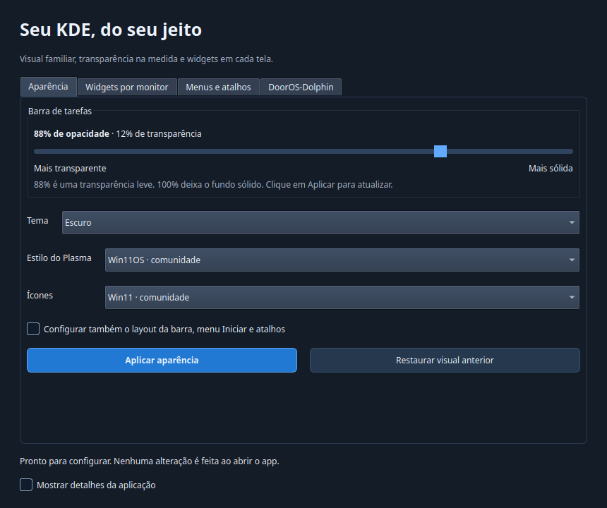
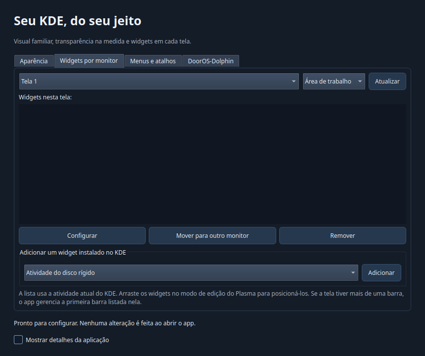

# KDE Windows Style

Aplicativo para aproximar o KDE Plasma do Windows 11, com **interface gráfica**,
controle de **opacidade da barra**, temas e ícones da comunidade e gerenciamento
de **widgets por monitor**. Inclui o **DoorOS-Dolphin** pré-compilado.

Testado no **Ubuntu/Kubuntu 26.04 x86_64, KDE Plasma 6 em Wayland**.
O perfil começa com **88% de opacidade**, para uma transparência leve.



## Instalar com um comando

Na sessão KDE, execute **sem sudo**:

```bash
curl -fsSL https://raw.githubusercontent.com/Rk7gamerYT/kde-windows-style/main/install.sh | bash
```

O instalador baixa o **pacote completo**, verifica o checksum e adiciona
**KDE Windows Style** ao menu de aplicativos. Abrir o app não aplica alterações.
Selecione suas preferências e clique em **Aplicar aparência**.

## Baixar, extrair e instalar sem internet

1. Baixe `kde-windows-style-ubuntu26.04-x86_64.tar.xz` em [Releases](https://github.com/Rk7gamerYT/kde-windows-style/releases/latest).
2. Extraia o arquivo.
3. Dentro da pasta extraída, execute:

```bash
./install-local.sh
```

Depois de baixar, a instalação e o uso normal não precisam de `pip`, `git`,
compilação ou download de temas. O pacote inclui:

- interface Qt/Python e seus wheels PySide6/Shiboken;
- Win11 icon theme e Win11OS Plasma Theme, de yeyushengfan258;
- Fluent icon theme, de vinceliuice, como alternativa;
- DoorOS-Dolphin pré-compilado para Ubuntu 26.04, além dos fontes;
- scripts, instruções, licenças e ferramentas de restauração.

**O sistema já precisa ter Ubuntu/Kubuntu 26.04 x86_64 com KDE Plasma 6**, Python 3.12+
e os utilitários padrão do Plasma (`qdbus6`, `kwriteconfig6`, `gdbus`, `systemctl`).
As bibliotecas nativas de Qt/KDE, Python e o próprio sistema operacional não são
redistribuídos como uma máquina virtual. O pacote usa os componentes do KDE instalado.

## Aparência

- Controle de 50% a 100% para a opacidade aplicada ao fundo da barra.
- Tema claro ou escuro.
- Estilo Win11OS da comunidade ou Breeze do KDE.
- Ícones Win11, Fluent ou manter os ícones atuais.
- Opção para configurar também layout, menu Iniciar e atalhos.
- Painel inferior de 48 px, menu à esquerda, tarefas com ícones, bandeja, relógio e mostrar desktop.
- Duplo clique para abrir arquivos, com os botões das janelas à direita.

Para ajustar só a aparência e a opacidade, deixe desmarcada **Configurar também o
layout da barra, menu Iniciar e atalhos**. Assim seus widgets e atalhos atuais são mantidos.
A intensidade final depende também da arte do tema e dos efeitos do compositor.
A barra principal é o primeiro painel inferior; os demais painéis são preservados.
O app não troca seu wallpaper nem apaga jogos, arquivos ou aplicativos.

## Widgets por monitor



Escolha a tela e depois **Área de trabalho** ou **Barra de tarefas**. É possível:

- listar os widgets presentes nessa área;
- adicionar widgets que já estão instalados no KDE;
- abrir a janela nativa de configuração;
- remover o widget selecionado, mediante confirmação;
- mover um widget para outra tela, preservando sua identidade e configuração.

A lista respeita a atividade atual. Se não houver barra no monitor selecionado,
o app não altera a barra de outra tela. Crie uma barra pelo editor do Plasma ou
escolha a área de trabalho. Se houver múltiplas barras na mesma tela, a interface
mostra a primeira delas. A posição fina dos widgets é ajustada no modo de edição do KDE.

## Menus e atalhos

Ao aplicar também o layout e os atalhos:

| Teclas | Ação |
|---|---|
| Win | Menu Iniciar / pesquisa de aplicativos |
| Win+E | Dolphin; pode ser trocado pelo DoorOS-Dolphin na aba própria |
| Win+R | Executar/pesquisar com KRunner |
| Win+I | Configurações do KDE |
| Win+D | Mostrar área de trabalho |
| Win+Tab | Visão geral |
| Alt+Tab | Alternar entre janelas |
| Alt+F4 | Fechar janela |
| Win+Shift+S | Capturar região com Spectacle |
| Print | Abrir Spectacle |

O perfil remapeia as ações correspondentes do KWin, KRunner e Spectacle.
Se outra aplicação ocupa uma combinação, ela é preservada e o conflito aparece
nos detalhes. São mantidas alternativas nativas como Alt+Space, Alt+F2 e Win+W.
O menu do KDE também recebe entradas para o app, restaurar o perfil e abrir as configurações.

## DoorOS-Dolphin

A aba **DoorOS-Dolphin** permite registrar o aplicativo, abri-lo e, se você quiser,
defini-lo como padrão para pastas e para Win+E. Há um botão para voltar ao gerenciador anterior.
O binário é instalado dentro deste pacote, sem sobrescrever `/usr/bin/dolphin`.
As preferências de visualização do Dolphin podem ser compartilhadas com a versão do sistema.

A versão inclusa é baseada no Dolphin **26.08.1**, commit
`a5b4f9186ed146f1e7804fada86cde8277a0df97` do [DoorOS-Dolphin](https://github.com/Rk7gamerYT/DoorOS-Dolphin).
Os fontes completos desse commit estão em `vendor/dooros-dolphin-source.tar.gz`.
Sua redistribuição pública neste pacote foi autorizada pelo proprietário do projeto.

Para compatibilidade com as bibliotecas do Ubuntu 26.04, a compilação desativa as
integrações opcionais com Baloo/Baloo Widgets 26.08, telemetria e PackageKit.
Isso pode deixar o painel de informações e recursos de metadados/indexação indisponíveis.
O modo clássico upstream pode ser utilizado com `DOOROS_DOLPHIN_CLASSIC=1`.

## Backup e restauração

Antes de aplicar um perfil, o app cria um backup em:

```text
~/.local/state/kde-windows-style/backups/
```

**Restaurar visual anterior** volta ao backup original, mesmo após reaplicar o perfil.
Isso restaura as configurações e o layout do backup: widgets e mudanças de layout
feitos posteriormente também podem ser desfeitos. A interface pede confirmação.
A troca do gerenciador padrão é desfeita pelo botão da aba DoorOS-Dolphin.

Por terminal, dentro da pasta do app:

```bash
./kde-windows-style.sh --restore
./kde-windows-style.sh --restore latest
./kde-windows-style.sh --restore /caminho/do/backup
```

Os caminhos respeitam as variáveis XDG. A aplicação recarrega brevemente o Plasma;
a barra pode desaparecer por alguns segundos. Uma falha tenta restaurar o backup da operação.

## Usar pelo terminal / desenvolver

```bash
./kde-windows-style.sh --dry-run
./kde-windows-style.sh --opacity 90 --style win11 --icon-theme win11 --theme dark
./kde-windows-style.sh --appearance-only --opacity 94 --no-icons --style breeze
./launch.sh
```

Um clone de desenvolvimento sem os wheels utiliza um ambiente virtual local e baixa
PySide6 na primeira abertura. Isso não acontece no pacote completo de Releases.
Os temas e ícones são fixados por commit e verificados com SHA-256.

Para recompilar o DoorOS-Dolphin no Ubuntu 26.04:

```bash
python3 dooros.py --build --install-deps
```

Somente a instalação das dependências de compilação pede autenticação.
CMake/Ninja executam no usuário normal, com duas tarefas paralelas, e o resultado
vai para `vendor/dooros-dolphin`. Nenhum binário do sistema é substituído.
A receita de compilação está em `dooros.py`, e a lista de dependências em `build-deps.py`.

Testes:

```bash
./launch.sh --setup
QT_QPA_PLATFORM=offscreen PYTHONPATH="$PWD/.runtime" python3 -m unittest discover -s tests -v
```

Em um clone sem runtime incluso, use `.venv/bin/python -m unittest discover -s tests -v` após preparar a interface.

Os testes não alteram o desktop real. Também foram verificados ao vivo aplicação,
restauração e adição/movimento/remoção de um widget entre dois monitores.

## Créditos e licenças

O código deste app é MIT. Temas, ícones, bibliotecas e Dolphin mantêm suas licenças
originais; veja [THIRD_PARTY.md](THIRD_PARTY.md). Não é um produto da Microsoft.
Não é necessário instalar Kvantum nem exportar variáveis de tema Qt globalmente.
